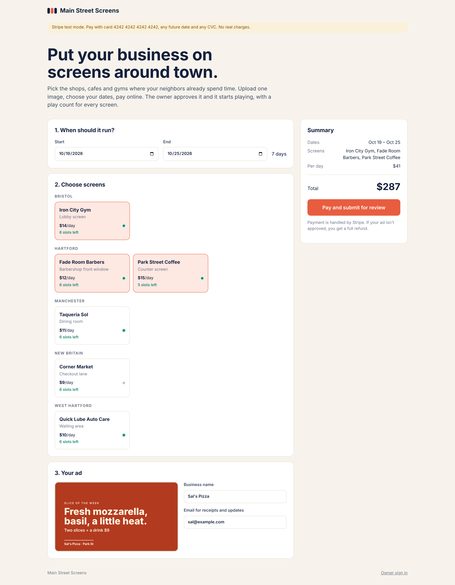
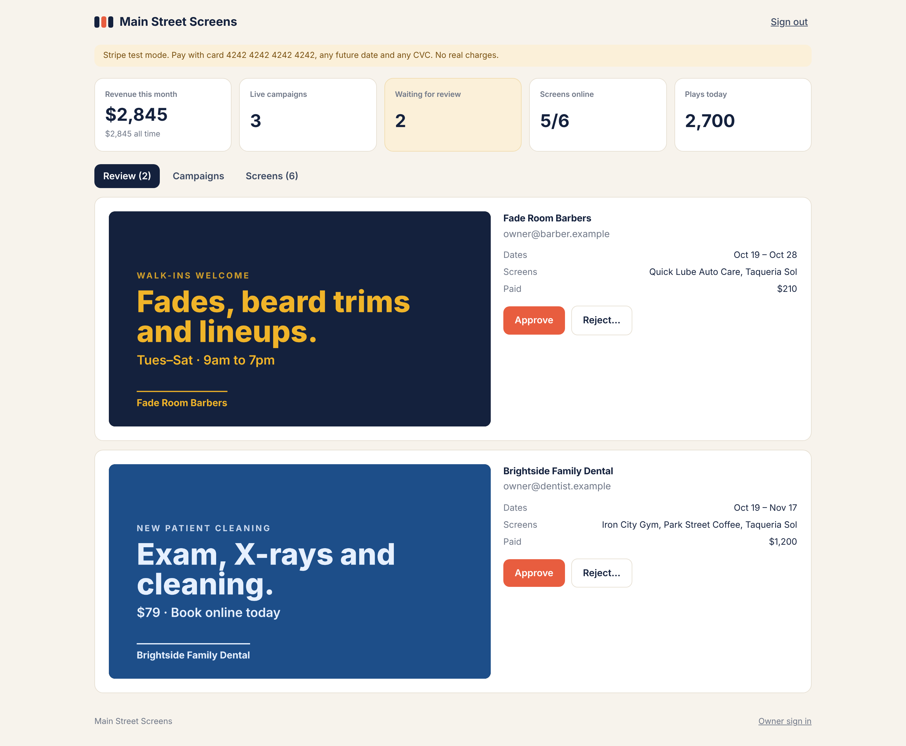
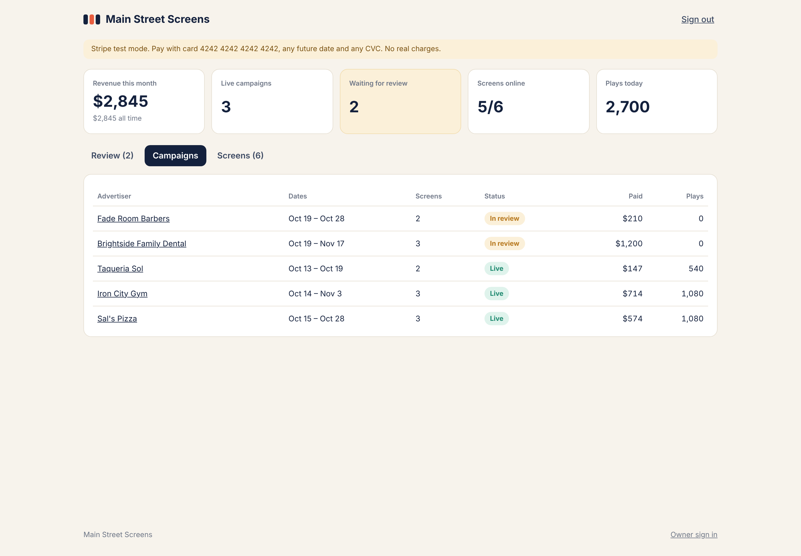
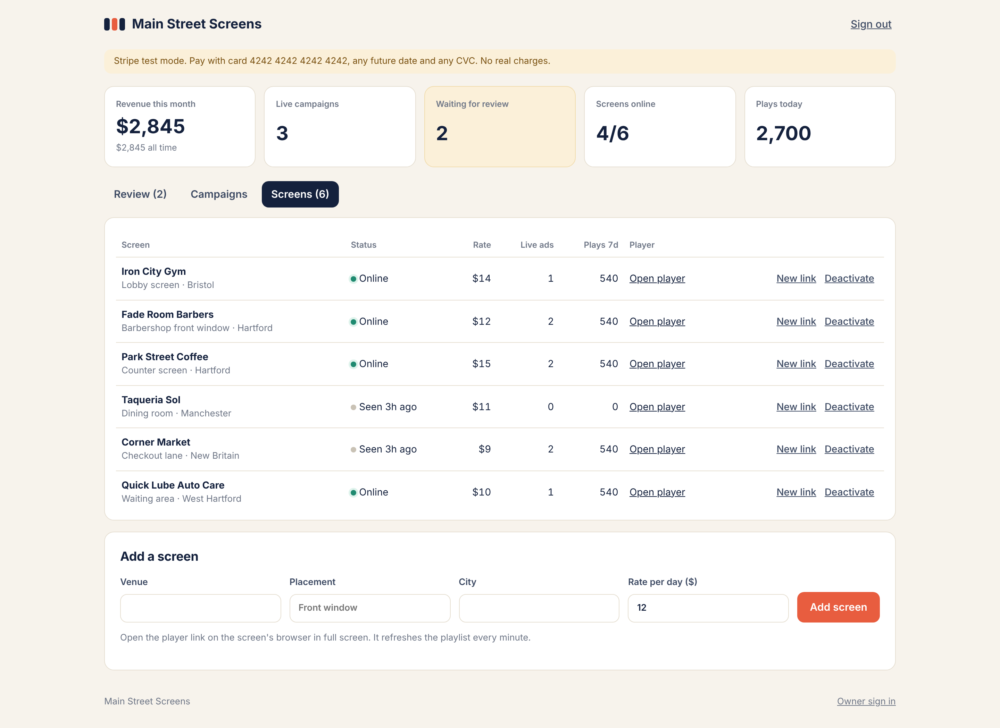
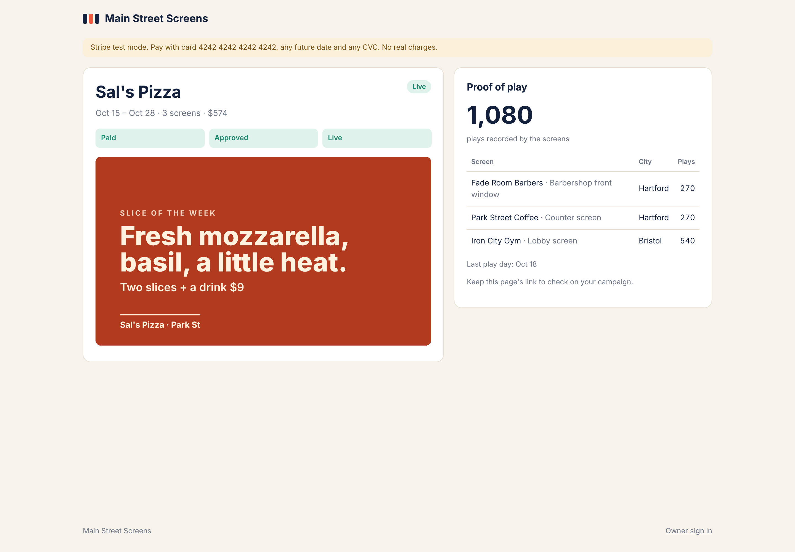
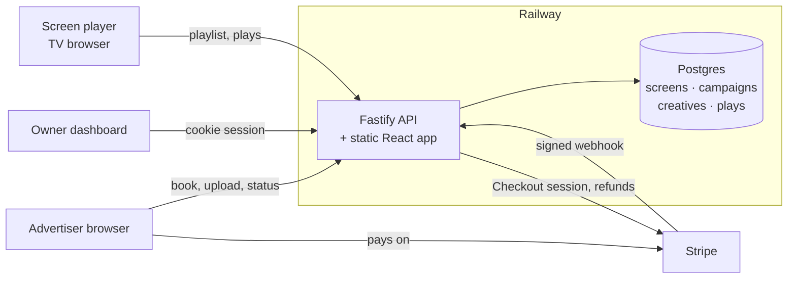
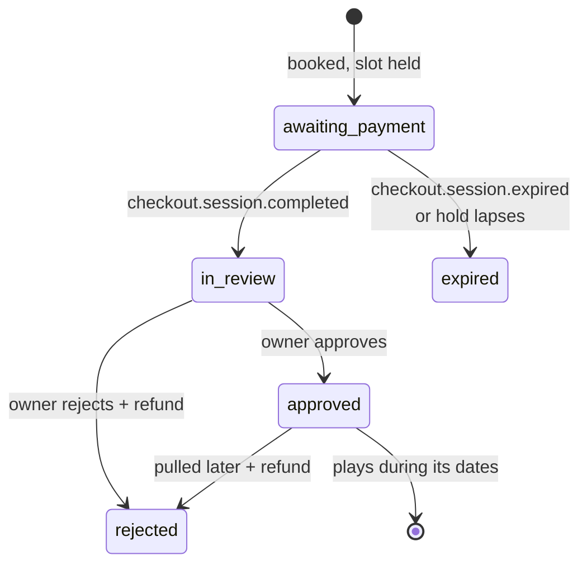

# Ad Screen Network

[](https://github.com/tonycmoney/ad-screen-network/actions/workflows/ci.yml)

Software for running a network of ad screens in local businesses: TVs in barbershops, cafes, gyms and waiting rooms. Local advertisers book screens and pay online, the network owner approves the creative, and each screen plays its own live playlist and reports proof of play.

**Live:** https://web-production-7b56.up.railway.app (Stripe test mode, so card `4242 4242 4242 4242` works and nothing is charged)



## What it does

**For advertisers**
- Pick dates and screens grouped by city, with each screen's daily rate and how many slots are left on those dates.
- Upload one image (PNG, JPEG or WebP), see the price, and pay through Stripe Checkout.
- Follow the campaign on a private status page: paid, approved, live, plus play counts per screen.
- If the owner rejects the ad, the payment is refunded in full automatically.

**For the network owner**
- Dashboard with revenue, live campaigns, the review queue, screens online and plays today.
- Approve, or reject with a reason that the advertiser sees.
- Add screens, set rates and slot length, deactivate screens, and issue a new player link if one leaks.

**On each screen**
- Open `/play/<key>` in the TV's browser in full screen. It refreshes the playlist every minute, rotates the approved ads and records every play.
- Plays are buffered in local storage and uploaded in batches, so a Wi-Fi drop loses nothing.
- When no ad is booked, the screen shows an "Advertise on this screen" slide with a QR code that opens the booking page with that screen preselected.

| Owner review queue | Campaigns |
| --- | --- |
|  |  |

| Screens | Advertiser status page |
| --- | --- |
|  |  |

| Screen player | Empty screen |
| --- | --- |
|  |  |

Screenshots come from a local run of the real booking, payment, review and play recording code against a simulated payment gateway (`server/scripts/simulate.ts`). The businesses and ads are made up.

## Architecture



### Booking lifecycle



### Design notes

- **No overbooking.** Each screen has a fixed number of slots per day. A booking locks the chosen screen rows (`SELECT ... FOR UPDATE`) and checks the busiest single day in the range, so two people cannot both buy the last slot, and back to back campaigns do not block each other.
- **Holds expire.** An unpaid booking holds its slot for 35 minutes. Stripe's `checkout.session.expired` webhook releases it sooner, and a failed checkout creation releases it immediately.
- **Webhooks are verified and idempotent.** Signatures are checked against the raw request body, every event id is recorded once, and a payment only applies to the session it was created for.
- **Uploads are checked by content.** The server reads the file's magic bytes and ignores the browser's file name and type, so an SVG or HTML file renamed to `.png` is rejected. Creatives are served with `Content-Security-Policy: default-src 'none'` and `nosniff`.
- **Owner auth.** One admin password from the environment, constant time comparison, five attempts per minute per IP, and a random session token stored hashed in Postgres behind an `HttpOnly`, `SameSite=Strict` cookie.
- **Fails closed.** Without Stripe keys the booking and webhook endpoints return 503. Without `ADMIN_PASSWORD` the dashboard cannot be signed in to.
- **Real SQL in every test.** The database layer is a small interface over `node-postgres` in production and [PGlite](https://pglite.dev) (Postgres compiled to WASM) in tests, so the suite runs real Postgres queries with no server. CI runs it again against Postgres 16.

| Layer | Choice |
| --- | --- |
| API | Node 22, TypeScript, Fastify 5, Zod |
| Database | Postgres (node-postgres), PGlite for tests and local runs |
| Payments | Stripe Checkout, webhooks, refunds |
| Web | React 19, TypeScript, Vite |
| Tests | Vitest: 40 server tests (90% coverage) and 10 web tests |
| Deploy | Docker multi stage image on Railway |

## Project layout

```
server/
  src/
    booking.ts     dates, pricing, per day capacity (pure functions)
    service.ts     booking, payments, review, playlist, proof of play
    payments.ts    Stripe gateway behind an interface
    auth.ts        owner sessions and login rate limiting
    images.ts      upload type detection
    app.ts         HTTP routes
    migrations.ts  schema
  test/            API, booking rules, Stripe signing
  scripts/simulate.ts
web/
  src/pages/       BookPage, CampaignPage, AdminPage, PlayerPage
```

## Running locally

Requirements: Node 22.

```bash
# API on :8000 with an in-memory database and starter screens
cd server
npm install
SEED_EXAMPLE_SCREENS=true ADMIN_PASSWORD=choose-a-long-one npm run dev

# Web app with hot reload on :5173 (proxies /api to :8000)
cd web
npm install
npm run dev
```

To take payments locally, add Stripe test keys and forward webhooks with the Stripe CLI:

```bash
stripe listen --forward-to localhost:8000/api/stripe/webhook   # prints a whsec_ secret
STRIPE_SECRET_KEY=sk_test_... STRIPE_WEBHOOK_SECRET=whsec_... npm run dev
```

### Configuration

| Variable | Default | Notes |
| --- | --- | --- |
| `DATABASE_URL` | in memory | Postgres URL in production, or `pglite://./pgdata` to keep local data |
| `STRIPE_SECRET_KEY` | none | `sk_test_...` for test mode |
| `STRIPE_WEBHOOK_SECRET` | none | Signing secret of the webhook endpoint |
| `ADMIN_PASSWORD` | none | 10+ characters, enables the owner dashboard |
| `NETWORK_NAME` | Main Street Screens | Shown on every page |
| `NETWORK_TIMEZONE` | America/New_York | Decides what "today" is for bookings and playlists |
| `MAX_CAMPAIGNS_PER_SCREEN` | 8 | Advertisers sharing one screen's loop per day |
| `PUBLIC_URL` | request host | Base for Stripe success and cancel links |
| `SEED_EXAMPLE_SCREENS` | false | Adds six starter screens to an empty database |

## Tests and CI

```bash
cd server && npm test        # 40 tests on PGlite
cd web && npm test           # 10 tests
```

GitHub Actions on every push:

- **Server:** oxlint, TypeScript, Vitest with an 85% line coverage floor, the same suite on Postgres 16, production build.
- **Web:** oxlint, TypeScript, Vitest, production build.
- **Docker:** builds the image, starts it with no secrets and checks it serves the app, lists screens, and returns 503 for bookings, webhooks and sign in.

## Deploying on Railway

1. Create a project with a Postgres database and a service from this repo. `railway.json` builds the Dockerfile and health checks `/api/health`.
2. Set `DATABASE_URL=${{Postgres.DATABASE_URL}}` and `PORT=8000`.
3. In Stripe (test mode), copy the secret key and add a webhook endpoint at `https://<your-domain>/api/stripe/webhook` for `checkout.session.completed` and `checkout.session.expired`.
4. Add `STRIPE_SECRET_KEY`, `STRIPE_WEBHOOK_SECRET` and `ADMIN_PASSWORD` as service variables.

## License

MIT
